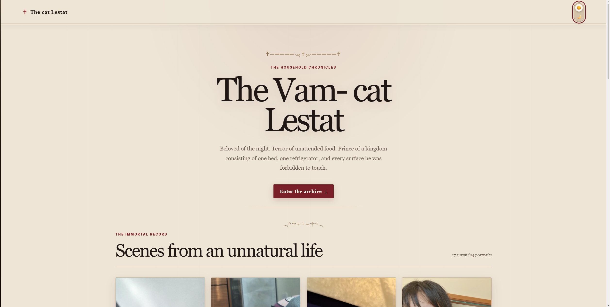
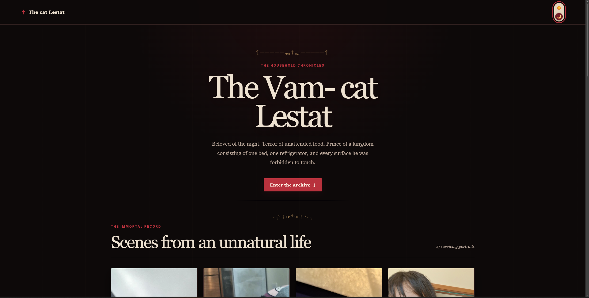

# The Vampire Lestat

A responsive photo gallery dedicated to my cat, Lestat.

The project takes visual and tonal inspiration from the theatrical gothic atmosphere of AMC's *Interview with the Vampire*, the television series that inspired Lestat's name. It presents seventeen photographs as scenes from the domestic life of an immortal, dramatic, and frequently sleeping creature of the night.

## Preview

### Light theme



### Dark theme



## Live website

[View The Vampire Lestat gallery](https://maria-d-soares-dev.github.io/the-cat-lestat-gallery/)

## Features

- Responsive Pinterest-style photo gallery
- Seventeen original photographs of Lestat
- Light and dark themes
- Theme preference saved with `localStorage`
- Automatic detection of the visitor's system theme
- Responsive layouts for desktop, tablet, and mobile screens
- Natural image proportions without forced cropping
- Sticky translucent header
- Accessible theme control with keyboard focus support
- Reduced-motion support
- Semantic HTML structure
- Custom captions written for every photograph

## Built with

- HTML5
- CSS3
- JavaScript
- CSS multi-column layout
- CSS custom properties
- `localStorage`
- `prefers-color-scheme`
- `prefers-reduced-motion`

No frameworks or external JavaScript libraries were used.

## Theme switcher

The theme control changes the value of the `data-theme` attribute on the root HTML element:

```html
<html lang="en" data-theme="dark">
```

The dark theme is activated through CSS:

```css
html[data-theme="dark"] {
    --page-background: #0d0909;
    --surface-background: #181111;
    --primary-text: #eee2cf;
    --accent-color: #b8323d;
}
```

JavaScript checks for a previously saved preference:

```javascript
const savedTheme = localStorage.getItem("cat-gallery-theme");
```

If no preference has been saved, the page uses the visitor's system setting:

```javascript
const systemPrefersDark = window.matchMedia(
    "(prefers-color-scheme: dark)"
).matches;
```

The selected theme remains active when the page is refreshed or reopened.

## Masonry gallery

The gallery uses CSS columns to create a Pinterest-style masonry layout:

```css
.photo-grid {
    column-count: 4;
    column-gap: 22px;
}

.photo-card {
    display: inline-block;
    width: 100%;
    break-inside: avoid;
}
```

Each photograph keeps its natural proportions:

```css
.photo-card img {
    width: 100%;
    height: auto;
}
```

The number of columns changes according to the available screen width:

- Four columns on large desktop screens
- Three columns on smaller desktop screens
- Two columns on tablets and most phones
- One column on very narrow screens

## Accessibility

The project includes:

- Descriptive alternative text for every photograph
- Semantic elements such as `header`, `main`, `section`, `article`, and `footer`
- An accessible label for the theme checkbox
- Visible keyboard focus styles
- Reduced animation for visitors using `prefers-reduced-motion`
- Responsive text and spacing
- Theme colors controlled through reusable CSS variables


## What I practised

This project was created to practise:

- Structuring a complete webpage with semantic HTML
- Building responsive layouts without a framework
- Creating a masonry-style gallery with CSS columns
- Designing coordinated light and dark color palettes
- Managing interface state with JavaScript
- Saving user preferences with `localStorage`
- Using media queries for responsive design
- Writing accessible controls and image descriptions
- Organizing image assets and project files
- Publishing a static website through GitHub Pages

## Possible future improvements

- Open photographs in an accessible lightbox
- Add next and previous controls to the lightbox
- Add category filters for sleeping, household occupation, and portraits
- Display the date associated with each photograph
- Add loading placeholders for slower connections
- Convert large photographs to WebP or AVIF
- Add `srcset` for responsive image loading
- Include additional photographs as the archive grows

## Image rights and attribution

All cat photographs displayed in this project are personal images and are not licensed for reuse.

This is an independent, non-commercial fan-inspired front-end project. It is not affiliated with or endorsed by AMC, Interview with the Vampire, or the creators and rights holders of The Vampire Chronicles.

No images, logos, video, audio, dialogue, or other media from the television series are included in the website.

## Author

Created by M. Eduarda Soares as a front-end development practice project.
